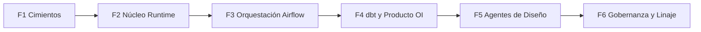

# Plan de Implementación / Implementation Plan (Producto OI)

---

## Español

> **FUENTE:** `Contex.md` / `AGENTS.md`. Cada fase respeta los 5 invariantes obligatorios (Cero IA en ejecución, fuente única de contratos, sigilo con Obscura, streaming a Rust con triaje binario y compuertas HITL).

### Resumen de Fases

| Fase | Alcance | Criterio de Salida |
| :--- | :--- | :--- |
| **F1 Cimientos** (completada) | Repositorio, validador de contratos, arnés de diseño, runtime en Rust, compose local, CI. | `pytest`, `cargo test`, `make new-ingestion` pasan. |
| **F2 Núcleo Runtime** (completada) | Extractor Python -> RustWorker -> SHA-256 -> RustFS Landing -> Tika solo para PDF/DOCX -> Carga en Bronze de PostgreSQL. | Prueba smoke end-to-end completada exitosamente. |
| **F3 Orquestación** (completada) | Airflow con DAGs declarativos YAML nativos (AIP-85) generados en tiempo de diseño. | DAGs parseados limpiamente; sin LLMs en ejecución; programación por YAML. |
| **F4 dbt / Producto OI** (completada) | Modelos Staging, Intermediate y Producto OI; tests generados desde contratos. | `dbt build` en verde; pruebas de calidad automáticas. |
| **F5 Agentes de Diseño** (completada) | `source-scout`, `source-assessor`, `silver-designer`, `arch-reviewer`, `gate-sentinel`; carriles Macro-H1. | Nuevas fuentes transcurren de Discovery a PR; humanos autorizan carril verde y PR. |
| **F6 Gobernanza** | OpenMetadata consumiendo eventos de Airflow y manifiestos de dbt; linaje de 5 capas. | Linaje de extremo a extremo visible para fuentes piloto. |

---

## English

> **SOURCE:** `Contex.md` / `AGENTS.md`. Every phase strictly adheres to the 5 mandatory invariants (Zero AI at runtime, single source of contracts, stealth via Obscura, stream-to-Rust with binary triage, and HITL gates).

### Phase Summary

| Phase | Scope | Exit Criteria |
| :--- | :--- | :--- |
| **F1 Foundations** (built) | Repo, contract loader/validator, dossier scaffold, Python base package, Rust runtime skeleton, local infra, CI. | `pytest`, `cargo test`, `make new-ingestion` pass. |
| **F2 Runtime core** (built) | Python extractor -> RustWorker -> SHA-256 -> RustFS Landing -> Tika only for PDF/DOCX -> PostgreSQL `bronze` load. | End-to-end smoke test passed; hash recorded; Tika called only for PDF/DOCX. |
| **F3 Orchestration** (built) | Airflow with declarative YAML DAGs generated from contracts at design-time (AIP-85). | DAGs parse; zero LLM import in DAG code; schedule driven by YAML. |
| **F4 dbt / Producto OI** (built) | Staging, Intermediate, and Producto OI models; tests generated from contract quality rules. | `dbt build` green; tests generated automatically. |
| **F5 Design-time agents** (built) | `source-scout`, `source-assessor`, `silver-designer`, `arch-reviewer`, `gate-sentinel`; Macro-H1 lanes. | Sources flow Discovery -> PR; humans authorize green lane + PR. |
| **F6 Governance** | OpenMetadata ingesting Airflow logs and dbt `manifest.json`; 5-layer lineage. | Lineage visible end-to-end for pilot sources. |
